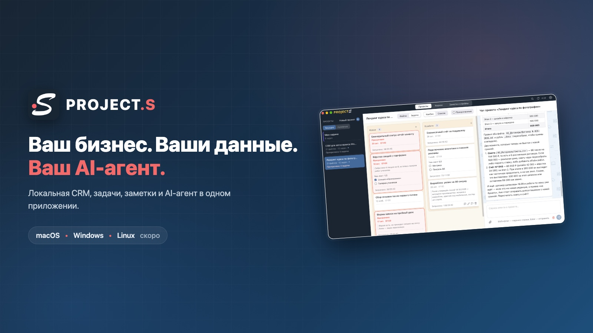
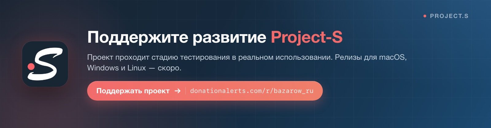
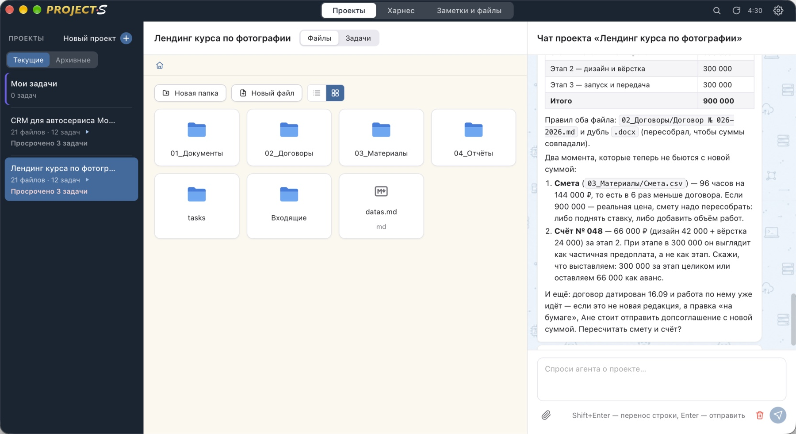
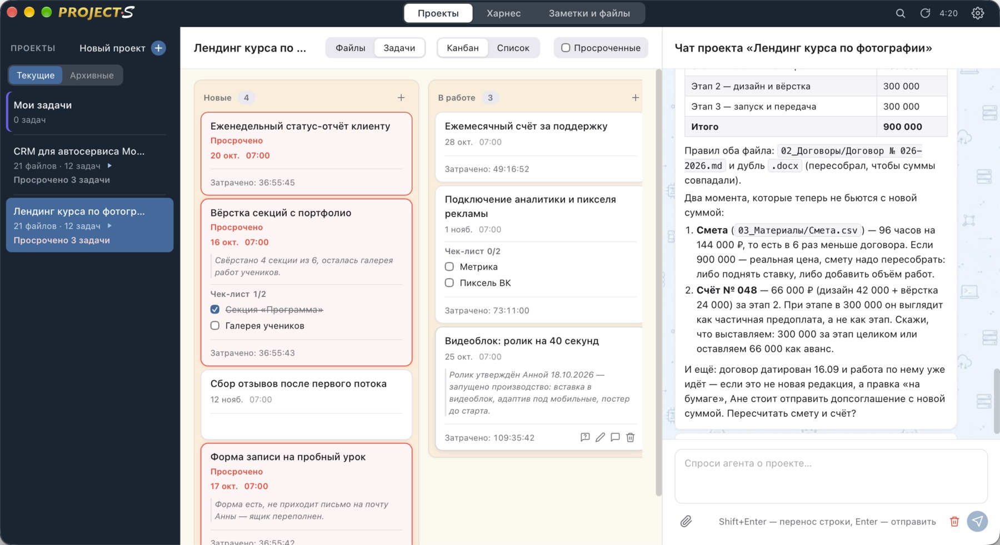
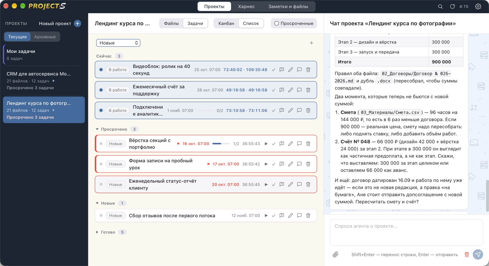
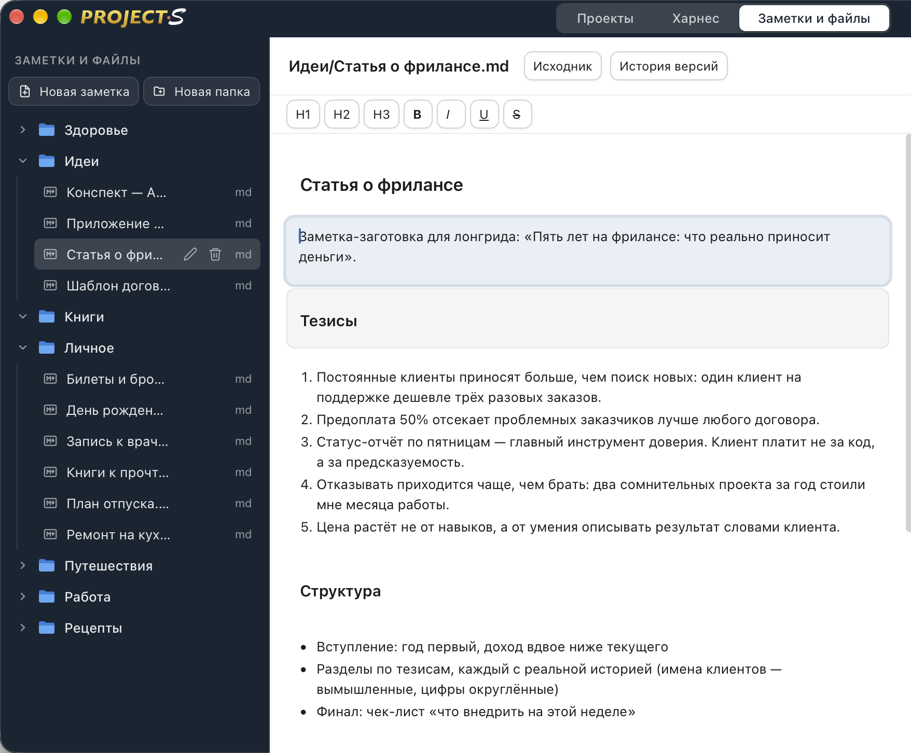
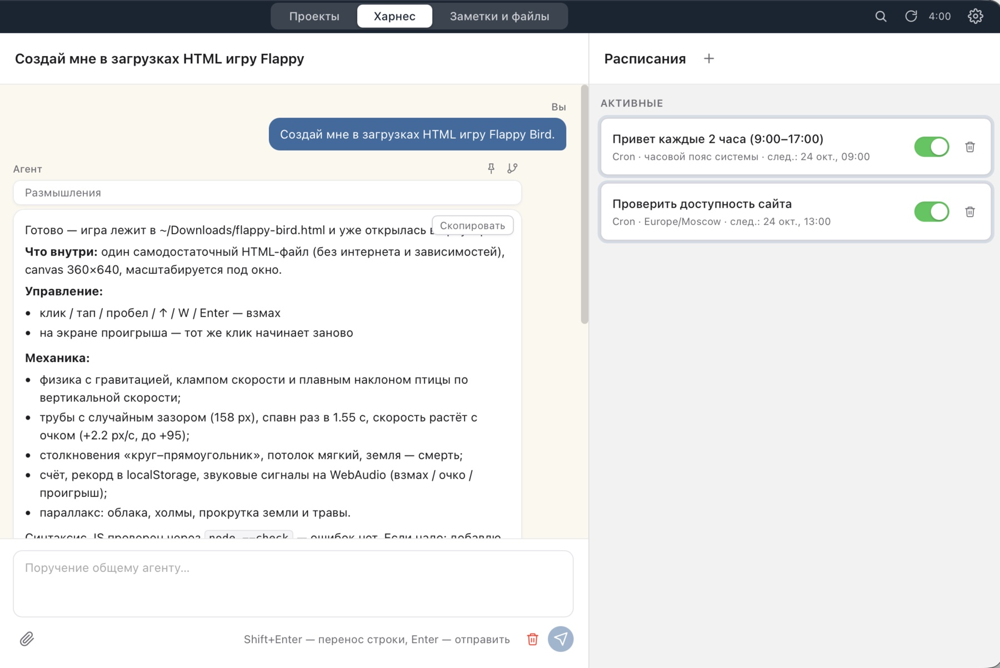
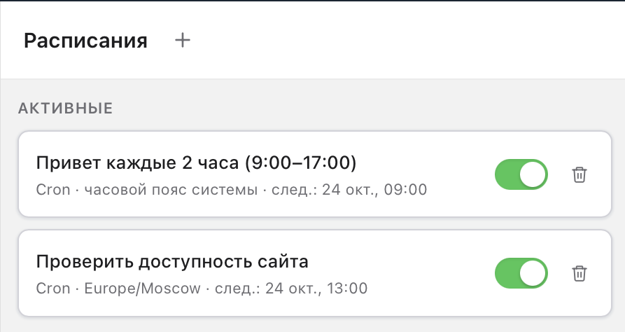
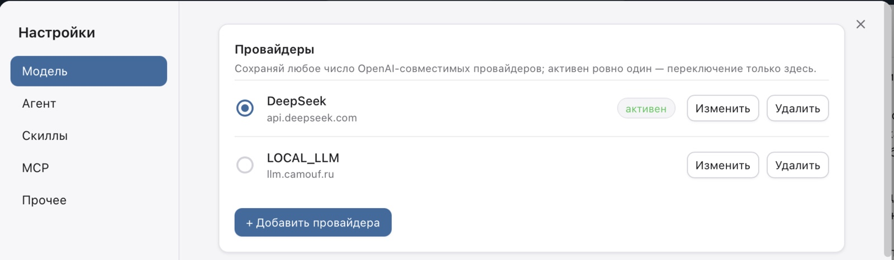
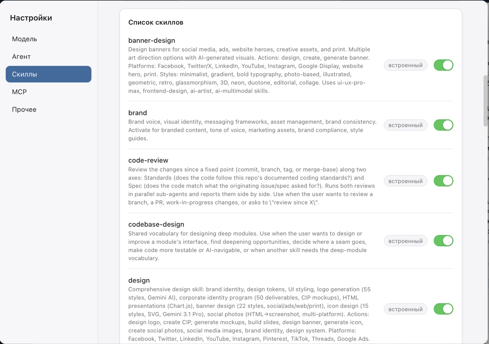

<p align="center">
  
</p>

# Project-S

**CRM, задачи, файлы и AI-агент — в одном приложении, которое работает на вашем компьютере.**

Project-S — локальное десктопное приложение для фрилансера, студии или небольшого агентства. Один проект — одна папка: в ней файлы, договоры, задачи, заметки и чат с агентом, который знает контекст этого проекта. Никакого облака и подписок: данные, ключи и история остаются у вас, а AI работает через ваши собственные ключи к любой OpenAI-совместимой модели.

**Релиз 1.2.1 опубликован для macOS и Windows: [Project-S 1.2.1](https://gitverse.ru/mibazarow/Project-S-local-CRM/releases/tag/v1.2.1). Linux — следом. Проект проходит стадию тестирования в реальном использовании.**

<p align="center">
  <a href="https://www.donationalerts.com/r/bazarow_ru">
    
  </a>
</p>

<p align="center">
Поддержать проект: <a href="https://www.donationalerts.com/r/bazarow_ru">DonationAlerts</a>
</p>

## Проблема

Фрилансер и маленькая студия живут в хаосе из вкладок: CRM в одном облаке, задачи в другом, файлы на диске и на FTP, договоры в почте, заметки в телефоне. Каждый сервис — отдельная подписка и отдельный ящик с вашими клиентскими данными: договоры, суммы, доступы. А универсальные AI-ассистенты из браузера ничего не знают о ваших проектах — им приходится пересказывать контекст вручную, и они видят только то, что вы вставили в чат.

## Решение

Project-S собирает работу в одно окно. Проект здесь — не запись в таблице, а настоящая папка на вашем диске: файлы, задачи с дедлайнами и таймерами, заметки, доступы. Справа — чат с агентом по этому проекту: он видит задачи, файлы и переписку и отвечает по делу. Отдельный режим «Харнес» — универсальный агент с доступом к компьютеру: файлы, терминал, браузер, SSH, расписания, память и готовые сценарии-скиллы.

## Почему Project-S

- **Локальность.** Приложение, база, индексы и ключи — на вашей машине. Клиентские договоры и суммы не уходят в чужое облако. Риск утечки через чужое облако больше не ваш.
- **AI с настоящим контекстом.** Агент отвечает не «вообще», а по вашему проекту: знает задачи, файлы, суммы договоров. Это меняет качество помощи с рабочих задач.
- **Экономика.** Нет подписки за CRM и за AI-платформу. Вы платите только за свои LLM-запросы — DeepSeek и аналоги стоят копейки, можно вообще уйти на локальную модель без оплаты API. Стоимость владения близка к нулю.
- **Свои правила и без lock-in.** Данные — обычные папки и SQLite-файл: их можно скопировать, забэкапить, открыть. Уйти из Project-S так же легко, как и начать.
- **Одна кодовая база для macOS, Windows и Linux.** macOS и Windows уже готовы, Linux — следующим пакетом. Продукт не привязан к одной платформе.

## Что умеет

### Проект — это папка

Файлы проекта живут в обычной директории: папки «Документы», «Договоры», «Материалы», «Отчёты». Их видно в Finder/Проводнике, их можно перетаскивать, переименовывать, предпросматривать — и при этом агент видит их содержимое.


*Файлы проекта: договоры и материалы под рукой, тот же экран — задачи и чат с агентом.*

### Задачи, которые не дают провалить срок

Канбан с колонками «Новые / В работе / Готово», дедлайны с точным временем, подсветка просрочки, таймер затраченного времени и чек-листы внутри задачи. Все задачи всех проектов — в едином списке «Мои задачи».


*Канбан проекта: просроченные задачи подсвечены, по каждой видно время в работе; справа — чат с агентом по проекту.*


*Список задач: группировка по статусу, прогресс чек-листов, затраченное время, дедлайны.*

### Заметки и файлы в одном месте

Личная база знаний: заметки в Markdown с историей версий плюс любые файлы — изображения, PDF, архивы. Папки «Здоровье», «Идеи», «Работа» — как в обычном файловом менеджере, но с быстрым поиском по содержимому.


*Заметки: Markdown-редактор, история версий и дерево папок личной базы знаний.*

### Харнес: агент, у которого есть руки

Универсальный агент с доступом к компьютеру: файлы, терминал, браузер, SSH, память, скиллы. Он выполняет задачу целиком — например, «создай в загрузках HTML-игру Flappy Bird»: написал файл, открыл в браузере, отчитался, что внутри. Опасные действия приложение всегда спрашивает.


*Харнес выполняет задачу от и до: файл создан в папке «Загрузки» и открыт в браузере. Справа — расписания агента.*

### Расписания: агент работает, пока вы отдыхаете

Запуски по расписанию прямо из интерфейса: «проверить доступность сайта каждый день в 13:00», «привет каждые 2 часа в рабочее время». Агент сам идёт в браузер или терминал и докладывает результат.


*Расписания: регулярные задачи агента с часовыми поясами и включением/выключением в один клик.*

### Свои модели, свои ключи

Сколько угодно профилей OpenAI-совместимых провайдеров — DeepSeek, Qwen, локальная модель на своём железе. Активный переключается в один клик, ключи хранятся только на машине.


*Провайдеры LLM: активный профиль, свои endpoint'ы, добавление нового провайдера в один клик.*

### 38 готовых скиллов

Встроенные сценарии для агента: работа с документами и презентациями, дизайн, код-ревью, поиск по кодовой базе и другие. Скиллы включаются тумблером — агент мгновенно получает новый навык.


*Скиллы: встроенные навыки агента с описаниями, включаются и выключаются тумблером.*

## Для кого

- **Фрилансеры и частные мастера**: клиенты, договоры, задачи и файлы — в одном окне, без облачных CRM и их подписок.
- **Маленькие студии и агентства**: проектная работа с дедлайнами и агентом, который ведёт рутину — поиск, подготовку документов, мониторинг.
- **Все, кто работает с чувствительными данными**: договоры, персональные данные клиентов, доступы — всё остаётся на вашем компьютере.

## Локальность и безопасность

- Приложение не имеет своего сервера: ни один клиентский договор не лежит в чужом облаке.
- Ключи LLM, база, чаты и индексы — в вашей рабочей папке; бэкап = обычное копирование.
- Опасные действия агента (удаление, терминал, SSH, сеть) выполняются только после вашего подтверждения; удаления — в корзину, с отменой.
- Вы платите модели напрямую через свой ключ — посредника в виде сервиса-облака нет.

> На скриншотах — вымышленные демонстрационные данные (несуществующие клиенты, договоры и адреса).

## Платформы и релизы

- **macOS** (Apple Silicon) — **1.2.1 опубликован:** DMG `Project-S-1.2.1-macOS-ARM.dmg`, ~22 МБ.
- **Windows 11** (x64) — **1.2.1 опубликован:** ZIP `Project-S-1.2.1-Windows-x64-Setup.zip`, внутри NSIS-установщик ~14 МБ.
- **Linux** — скоро: один Flatpak-пакет для большинства дистрибутивов.

Модель эмбеддингов Gemma 2 (~300 МБ) не вшита в установщик: приложение скачивает её один раз после онбординга с Hugging Face и показывает прогресс. Без неё поиск работает только по словам — установщик из-за этого заметно меньше.

Релизы публикуются в GitVerse ([репозиторий Project-S-local-CRM](https://gitverse.ru/mibazarow/Project-S-local-CRM)) и зеркалятся на GitHub ([Project-S-local-CRM](https://github.com/mibazarow/Project-S-local-CRM)): macOS и Windows уже в [релизе 1.2.1](https://gitverse.ru/mibazarow/Project-S-local-CRM/releases/tag/v1.2.1). Linux — следом.

Автоматической установки обновлений пока нет: приложение проверяет обновления раз в 8 часов и показывает баннер новой версии. Как поставить новую версию вручную — [UPDATES.md](UPDATES.md).

## Техническая основа

Если коротко: Tauri 2 + Rust (агентный луп, SQLite, поиск, планировщик) и React + TypeScript для интерфейса. Поиск — SQLite FTS5 плюс локальные нейросетевые эмбеддинги на ONNX Runtime, без Python и без облака. Полная архитектура, инструменты агента, сборка и тесты — в [`DOCS/about.md`](DOCS/about.md).

## Что дальше

- Публичные релизы в GitVerse и на GitHub: macOS и Windows 1.2.1 — опубликованы; Linux Flatpak — следом.
- Linux-порт и доводка Windows (подпись, автообновление).
- Расширение скиллов и интеграций агента, полировка UI по очереди задач от реальных пользователей.

## Попробовать

**Релиз 1.2.1:** [Project-S 1.2.1 — macOS + Windows](https://gitverse.ru/mibazarow/Project-S-local-CRM/releases/tag/v1.2.1) · [зеркало на GitHub](https://github.com/mibazarow/Project-S-local-CRM/releases/tag/v1.2.1).

- **macOS (Apple Silicon):** скачайте `Project-S-1.2.1-macOS-ARM.dmg`, откройте DMG и перетащите Project-S в Applications. Сборка не нотаризована: при первом запуске может понадобиться правый клик по приложению → «Открыть».
- **Windows 11 x64:** скачайте `Project-S-1.2.1-Windows-x64-Setup.zip`, распакуйте и запустите `Project-S 1.2.1 Windows x64 Setup.exe`. Установщик не подписан: SmartScreen → «Подробнее» → «Выполнить всё равно».

После установки: онбординг — выбираете пустую папку для данных, добавляете провайдера LLM (или локальную модель) — и работаете. Модель эмбеддингов (~300 МБ) скачается после онбординга; без неё поиск работает по словам.

Поддержать проект: [DonationAlerts](https://www.donationalerts.com/r/bazarow_ru) — это ускоряет выход релизов и портов.

## Для разработчиков

```bash
npm install
npm run tauri dev     # приложение в dev-режиме
npm test              # фронтенд-тесты (vitest)
cargo test            # бэкенд-тесты (из src-tauri)
scripts/check.sh      # контроль качества: fmt → clippy → тесты → сборка
```

Устройство продукта, архитектура агента, требования к сборке и модель эмбеддингов — в [`DOCS/about.md`](DOCS/about.md). Исходники Project-S открыты для просмотра в публичном репозитории; это не даёт прав на модификацию или распространение изменённых версий без разрешения автора.

## Лицензия и участие

Project-S — **source-available**: исходники доступны, но это не программа с открытым исходным кодом.

- **Официальные сборки** можно бесплатно использовать в любых целях, включая коммерческие: фриланс, студия, агентство, клиентские проекты. Отчислений и подписок нет.
- **Модификация** приложения — только с предварительного письменного разрешения автора.
- **Перепродажа и лицензирование** приложения или его изменённых версий — только с разрешения.
- **Исходники** открыты для просмотра в публичном репозитории. Это не даёт прав на модификацию, перепродажу или распространение изменённых версий без разрешения.
- **Авторство обязательно:** `Project-S by Михаил Базаров (bazarow.ru)` должно сохраняться в продукте, README или документации.

- Полный текст: [LICENSE.md](LICENSE.md)
- Безопасность: [SECURITY.md](SECURITY.md)
- Правила участия: [CONTRIBUTING.md](CONTRIBUTING.md)
- Кодекс поведения: [CODE_OF_CONDUCT.md](CODE_OF_CONDUCT.md)
